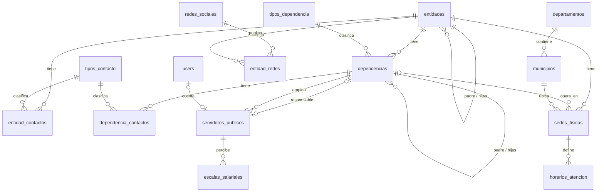

# Plan de corrección: base de datos y backend por módulo (v3.5, 2026-11-13)

Estado: **APROBADO por José el 2026-11-13 (plan, tabla de clasificación y auditoría de completitud). Sin ejecutar.** No se ha cambiado código, BD ni staging. Cada fase arranca solo cuando José aprueba su **ficha de fase** y termina con pruebas, verificación en Docker local y en staging, y su aprobación; el merge ocurre solo cuando él lo diga o la fase esté completa y aprobada. **HECHO** = leído en el repo o en documentación oficial; **INFERENCIA** = deducido; **HIPÓTESIS** = sin comprobar.

Documentos hermanos: `clasificacion-datos-sitio-e-investigacion-2026-11-13` (tabla archivo por archivo e investigación) y `auditoria-completitud-plan-v3-4-2026-11-13` (huecos A1–A12 y su origen).

## 1. Decisiones de José (acumuladas)

| Tema | Decisión |
|---|---|
| Datos | Todo en BD con backend completo por módulo; sin datos institucionales en el código (salvo el respaldo del pie, abajo); BD en 3FN. Principio: todo debe poder gestionarse desde el panel |
| Estructura | `dependencias` con padre e hijas; una entidad puede tener una o varias secretarías y el resto de la estructura |
| Entes | Dos niveles: `entidades` con `entidad_padre_id` (la Alcaldía es la raíz; un ente como INRED es entidad hija) y `dependencias` dentro de cada entidad |
| Reglas en BD | Todo en migraciones de Laravel; SQL crudo dentro de la migración solo donde el builder no llega (CHECK locales, únicos parciales, trigger anticiclos); la app usa un rol que no es dueño ni superusuario |
| Roles de BD | Migrador, app y lectura, con sus permisos, se crean **dentro de migraciones de Laravel** |
| Personas | `users` de Laravel + `servidores_publicos` enlazadas por `users.servidor_publico_id` |
| Archivos | `file_media` polimórfica reutilizable; se agrega `hash_sha256`; queda solo `model_id` y el uuid se resuelve al leer (se retira `model_uuid` con migración que rellena antes) |
| Frontera | BD: datos institucionales, contenido y catálogos editables. Código: textos de interfaz, validaciones y permisos del sistema. Despliegue: variables de entorno |
| Sitio y respaldos | Se eliminan `REDES_RESPALDO` y las diapositivas por defecto. **El pie y los datos de contacto conservan un respaldo en el código**, usado solo si la API no está disponible; cuando la API responde, manda la API. Orden: **API → caché de la última respuesta válida → código**. Un solo módulo de respaldo (no tres copias), solo con los campos del pie que tengan fuente verificada (la línea anticorrupción y el código postal `470004` no entran mientras no consten). Una prueba falla si el respaldo difiere de la carga inicial verificada. `useAsyncData` + Axios en servidor, TanStack Query solo en lo interactivo; Table v9, Router 5 |
| Menú | Menú del sitio y estado de publicación de cada sección en BD, editables desde el panel (`menus`); las rutas siguen siendo páginas de Nuxt |
| Catálogos legales | Tipos de solicitud, persona, documento, canales y tipos de norma: en código, deduplicados; a BD cuando el módulo PQRSD tenga backend |
| Tarjetas de portada | Se quedan en código |
| Dominios de confianza | Tabla en BD editable desde el panel (con permiso propio, validación y auditoría) |
| **Módulo Sede** | Configuración de la entidad raíz (la Alcaldía). **Mismo registro que Entidad, dos pantallas por alcance**: Sede edita solo la raíz; Entidad gestiona los entes adscritos y su estructura. Contenido: identidad, contacto y atención, institucional (misión, visión, funciones, organigrama) y estructura (dependencias). **Permisos propios `sede.ver` y `sede.editar`** |
| Organización | Carpetas por módulo solo en Vue; el backend Laravel conserva su estructura estándar |
| Alcance | Sus 6 módulos + contenido público (Fase 7) + privacidad y auditoría (Fase 8). Transparencia, los 16 marcadores del panel y los centros poblados del DANE, fuera por ahora |
| TLS a la BD | Activarlo en producción; en staging, riesgo aceptado y documentado |
| Teléfonos | Número normalizado en BD; formato al mostrar |
| Directorio público | Resource con lista blanca, sin RLS por ahora |
| Catálogo DANE | Fuente: archivo oficial DIVIPOLA (DANE) actualizado al 30 de octubre de 2026, que José adjuntó (§5). Solo departamentos y municipios |
| Datos sin fuente | Se cargan sin confirmar (`confirmado_en` vacío) y se ratifican desde el panel |
| **Flujo de trabajo** | Cada fase: ficha de fase aprobada → ejecución con TDD → **pila local en Docker** para revisar y probar → staging → aprobación de José → merge. **El merge solo cuando José lo diga o la fase esté completa y aprobada por él** |
| Docker local | No hay flujo documentado; se arma en la Fase 0 (`make local`) |
| Orden | Entidad y dependencias → roles → usuarios → políticas → trámites → sede → contenido público → privacidad y auditoría |

## 2. Auditoría de la v2: qué se escapaba

| # | Hueco | Evidencia | Corrección |
|---|---|---|---|
| G1 | La tabla real es **`entidads`**, no `entidades` | `Schema::table('entidads', …)` en `add_uuid_columns` | Fase 1: migración de renombrado y ajuste de `$table` y FK |
| G2 | Tablas existentes sin fase: `noticias`, `banners`, `consentimientos`, `audit_log`, `tramite_valoraciones`, `tramite_cuentas`, `ingesta_tramites`, `menus` | Listado de migraciones | Fases 2, 5, 7 y 8 |
| G3 | Datos institucionales en código del sitio (pie, `atencion.vue` y `accesibilidad.vue` con 3 copias que divergen, `redes-sociales.ts`, `realizar-una-peticion.vue`, `index.vue`, `CabeceraGovco.vue`, `useMetadatosComparticion.ts`, `sitemap.ts`, `useAvisoSalida.ts`). `politicas-contenido.ts` **ya no** guarda datos | Tabla de clasificación del hermano | Fases 1, 2 y 7 |
| G4 | **La app se conecta como superusuario de PostgreSQL** (confirmado con la doc de la imagen oficial) | `compose.yaml`, `deploy/*.env`, Docker Hub | Fase 0 |
| G5 | Conexión sin TLS (`ssl=off`) | `compose.yaml` | TLS en producción; staging con riesgo documentado |
| G6 | Respaldo, PITR y restauración de prueba ausentes (RNF-DISP-02); existe `docs/copias-de-seguridad.md` | `requisitos-no-funcionales.md` | Fase 0: auditar; ninguna migración con datos corre sin copia verificada |
| G7 | Faltan retención por tabla, registro de tratamiento y ARCO ≤ 15 días hábiles | RNF-PD-01 | Fase 8 |
| G8 | `consentimientos.categorias` es JSON (viola 1FN); `version_politica` sin FK | `create_consentimientos_table` | Fase 8 |
| G9 | Todo recurso nuevo necesita permisos, Policy, auditoría y contrato OpenAPI | `CatalogoPermisos`, `contract/openapi.yaml` | Regla de ejecución (§7) |
| G10 | Sin matriz de trazabilidad ni criterios de aceptación por fase | `08-trazabilidad` | Ficha de fase con matriz RF → tabla → endpoint → prueba |
| G11 | 16 módulos marcadores en el panel | `panel/src/router/index.ts` | Fuera de alcance |
| G12 | Sin estrategia de despliegue para migraciones con datos; `down()` destructivo | `tramites_con_base_propia` | Protocolo expandir → migrar → contraer (§7) |
| G13 | Dos datos sin fuente verificada: línea anticorrupción (escrita de dos formas) y código postal `470004` | `atencion.vue`, `PiePaginaGovco.vue`, `accesibilidad.vue` | Se cargan sin confirmar y se ratifican desde el panel; no entran al respaldo del código |
| G14 | Comentario de migración dice «SQLite en las pruebas»; `phpunit.xml` y el CI usan PostgreSQL | `create_tramites_table`, `phpunit.xml` | Fase 0: limpiar ramas por motor |
| G15 | `uuid` `nullable` en `entidads`, `menus`, `tramites`, `ingesta_tramites` | `add_uuid_columns` | Se verifica el relleno y pasa a `NOT NULL` |
| G16 | El ER de la v2 omitía `servidores_publicos`, escala salarial, menús, pie y barra superior | v2 §4 | Fases 1, 2 y 3 |
| G17 | Índices y consultas críticas dejados «para después» | `indices-y-rendimiento.md` | Cada fase incluye sus índices y un `EXPLAIN` |
| G18 | `accesibilidad.vue` usa `www.santamarta.gov.co`; `nuxt.config.ts` usa `staging.santamarta.gov.co` | `nuxt.config.ts:128` | El dominio sale de `SEDE_DOMINIO` (despliegue) |
| G19 | El formulario de petición lista una sola dependencia escrita a mano | `realizar-una-peticion.vue:256` | Fase 1: sale de `dependencias` |
| G20 | «Sede» y «Entidad» editarían lo mismo; la especificación impone fuente única (RF-02-004) | Respuesta de José | Un solo registro raíz con dos pantallas (Fase 6) |
| A1 | No hay flujo local con Docker: el README manda `make dev` (no existe en el Makefile); `make preparar` migra en el anfitrión; `compose.yaml` exige secretos sin dar un entorno local; el override monta `panel/dist` | `Makefile`, `README.md`, `compose.yaml`, `compose.override.yaml` | Fase 0: `make local`, guía, prueba de humo y README corregido |
| A2 | Los roles de BD son globales del clúster: `migrate:fresh` y las pruebas no los borran; `CREATE ROLE` falla la segunda vez | Manual de PostgreSQL (no releído hoy) | Migración de roles **idempotente** |
| A3 | Las contraseñas de roles salen del entorno y no existen en CI ni en pruebas | `ci.yml`, `phpunit.xml` | Valores de prueba solo en pruebas; falla explícita si falta el secreto en staging o producción |
| A4 | Copia y restauración usan hoy el rol de la app (superusuario) | `docs/copias-de-seguridad.md`, `scripts/verificar-respaldo.sh` | Fase 0: fijar el rol de copia (HIPÓTESIS: `sede_lectura`) tras leer el script |
| A5 | Horizon y el programador también se conectan a la BD | `compose.yaml` | Se prueban con `sede_app` en Docker local |
| A6 | Sin predeterminados, las pruebas del sitio, la puerta visual y la accesibilidad necesitan datos de la API | `ci.yml`, `Makefile` | Fase 1: pruebas contra el simulador del contrato (HIPÓTESIS: confirmar el uso actual en CI) |
| A7 | Falta tabla de conversión de datos columna por columna (`entidads` guarda JSON y texto) | Migraciones | Cada ficha de fase la trae y se ensaya sobre una copia de staging |
| A8 | Falta plan de retroceso por fase | §7 | Cada ficha lo declara: restaurar la copia verificada y la rama |
| A9 | Falta documentación viva: ADR, trazabilidad, expediente | `docs/adr`, `docs/trazabilidad.md` | Cada fase los actualiza al cerrar |
| A10 | Criterios de aceptación por fase solo genéricos | §6 | Ficha de fase aprobada por José antes de ejecutar |
| A11 | Arranque en frío con API caída y sin caché | Decisión de José | Respaldo del pie en el código (§1) |
| A12 | Sin estimación por fase | — | Se entrega con cada ficha, rotulada como estimación |

## 3. Qué dice la especificación `entidad-transparencia` (HECHO)

**Entidad (pie GOV.CO, RF-01-002):** nombre, NIT, dirección, código postal, municipio y departamento, horario, redes, conmutador, línea gratuita, línea anticorrupción, correo institucional, correo de notificaciones judiciales, logo, mapa del sitio, enlaces a políticas. **Institucional (RF-02-005):** misión, visión, funciones, organigrama vigente (≤ 6 meses), directorio, plan de acción, informe de gestión, estados financieros, información tributaria.

**Dependencia:** código, nombre, descripción, padre, responsable, teléfono, correo, nivel, activa. **Servidor público:** dependencia, código SIGEP, identificación, nombres, apellidos, cargo, correo institucional, extensión, ingreso/salida, estado. Directorio público: solo nombre, cargo, dependencia, correo institucional y extensión (RN-01).

**Otras tablas de la especificación** (27 nuevas): `escala_salarial`, `menu_item`, `top_bar`, `top_bar_item`, `footer`, `footer_item`, `noticia`, `noticia_imagen`, `categoria_noticia`, `noticia_categoria`, `subseccion_transparencia`, `categoria_documento`, `tipo_documento`, `documento`, `documento_version`, `metadato_documento`, `archivo_storage`, `busqueda_log`, `documento_dependencia`, `instrumento_gestion`, `activo_informacion`, `informacion_clasificada`, `politica`, `ita_item`, `ita_evaluacion`, `alerta_publicacion`, `notificacion`, más `usuario`, roles y auditoría.

## 4. Defectos de la especificación que no se copian (HECHO)

| # | Defecto | Base |
|---|---|---|
| 1 | CHECK con `EXISTS (SELECT …)`; PostgreSQL 18 no admite CHECK que lea otras filas o tablas | Doc PostgreSQL 18, Constraints |
| 2 | Trigger de auditoría escribe `ip_oragen` (error de tipeo) | `politicas-integridad.md` §2.5 |
| 3 | `SET LOCAL … = '" . $request->ip() . "'`: SQL por concatenación; se usa `set_config` con parámetros | `politicas-integridad.md` §2.5 |
| 4 | Índice único sobre `dependencia (id)` no impone nada; la regla real es `UNIQUE (responsable_id) WHERE activa` | `politicas-integridad.md` §4 |
| 5 | `footer` guarda datos de la entidad y repite municipio/departamento (dependencia transitiva); no está en 3FN aunque la marca ✅ | `diccionario-datos.md` |
| 6 | No existe tabla de entidad | `modelo-er.md` |
| 7 | Dice PHP 8.3 y PostgreSQL 15+; el repo usa PHP 8.5 y PostgreSQL 18 | `README.md` |
| 8 | Erratas en el diagrama ER (`SERVIDOR_PUBLIGO`) | `04-diseno-bd/README.md` |
| 9 | `usuario` y `archivo_storage` propios: se sustituyen por `users` y `file_media` | Decisión de José |

## 5. Modelo de la Fase 1 y seguridad de BD

- `entidades` (renombrada desde `entidads`): `uuid` NOT NULL, `entidad_padre_id` (FK propia, `restrictOnDelete`), nombre, sigla, NIT único, misión, visión, funciones, dominio, activa. **Una sola raíz:** índice único parcial que impide más de un registro con `entidad_padre_id` nulo (SQL crudo dentro de la migración). Se retiran redes en JSON, políticas en JSON, país y direcciones en texto. El logo va a `file_media` (colección `logo`).
- `dependencias` se **extiende** (se conservan los ids que usan los trámites): `entidad_id`, `dependencia_padre_id`, `tipo_dependencia_id`, código, sigla, descripción, orden, activa e indicador de destino de solicitudes. Reglas con SQL crudo: `CHECK (id <> dependencia_padre_id)`; trigger de anticiclos, profundidad ≤ 5 y misma entidad entre padre e hija. Pruebas con PHPUnit sobre PostgreSQL (el CI usa `pgsql`).
- Catálogos editables: `tipos_dependencia` (valores de la especificación como carga inicial mínima), `tipos_contacto`, `redes_sociales`, `departamentos`, `municipios`, `dominios_confianza`.
- **Catálogo DANE (HECHO, verificado):** archivo oficial «DIVIPOLA octubre 2026», `Fuente: DANE`, actualizado al 30 de octubre de 2026: 8560 filas (1104 `CM` + 7456 `CP`), 33 departamentos, 1122 municipios; códigos de 2, 5 y 8 dígitos, únicos y encadenados. Santa Marta = `47001`, Magdalena = `47` con 30 municipios. Coincide con datos.gov.co en los 1122 códigos de municipio; difiere en 2 nombres (`19760` «SOTARÁ» vs «SOTARÁ - PAISPAMBA»; `13838` «TURBANA» vs «TURBANÁ»): **se toma el archivo del DANE**.
  - **Solo departamentos y municipios** (33 y 1122 filas); los 7456 centros poblados no entran por ahora.
  - **Derivación (comprobado):** los 1122 municipios salen de los pares distintos de código y nombre de **todas** las filas, no solo de las `CM` (son 1104; los 18 faltantes son probablemente áreas no municipalizadas, INFERENCIA por confirmar al cargar). Los 33 departamentos salen igual.
  - Cuidados: códigos como **texto** (`05`, `05001`); coordenadas con coma decimal (se normalizan si se guardan); nombres en mayúsculas como los publica el DANE; Bogotá, D.C. es departamento (`11`) y municipio (`11001`). Se revisan las notas al pie (Nuevo Belén de Bajirá, decreto 0284 de 2023; San Andrés) antes de cargar.
  - Importación: comando `divipola:importar <archivo>` (repetible; no es seeder); el archivo no se versiona en el repo.
  - Licencia: datos.gov.co es CC BY-SA 4.0; el archivo adjunto no declara licencia. Se anota la fuente («DANE, DIVIPOLA»).
- Contactos con número normalizado, sedes y horarios en tablas propias; `confirmado_en` nulo = dato por ratificar (reemplaza `datos_por_confirmar`).
- Las 13 dependencias actuales pasan a la Alcaldía, sin padre y con tipo «sin clasificar»; la jerarquía real la cargan José y la Entidad desde el panel.
- Organigrama: se arma desde el árbol; la imagen vigente va a `file_media` (colección `organigrama`).
- `dominios_confianza`: dominio (único, minúsculas, sin comodines ni esquema), activo, nota. Permiso `dominios.gestionar` solo para el súper administrador, auditoría de cada cambio y comportamiento a prueba de fallos: si la lista no llega de la API ni de la caché, el sitio trata todo enlace externo como salida y avisa.

**Seguridad de la BD** (documentación oficial de PostgreSQL 18 y de la imagen de Docker)

| Control | Diseño | Base |
|---|---|---|
| Roles | `sede_migrador` (dueño, solo migraciones), `sede_app` (solo DML, sin superusuario ni `BYPASSRLS`), `sede_lectura` (reportes y copia, a confirmar), **creados dentro de migraciones de Laravel**, idempotentes (A2). Primera corrida con el rol que hoy tiene permiso (el superusuario); después la app cambia a `sede_app` | HECHO: la imagen oficial crea `POSTGRES_USER` como superusuario; Row Security exime a superusuario, `BYPASSRLS` y dueño |
| `CREATE ROLE` | Exige `CREATEROLE` o superusuario; solo un superusuario crea superusuarios; `BYPASSRLS`, `REPLICATION` y `CREATEDB` solo los otorga quien ya los tiene. Los límites de `CREATEROLE` en PG16+ no constan en esa página: no se afirman | HECHO: PostgreSQL 18, CREATE ROLE |
| Contraseñas de los roles | De variables de entorno o secretos del despliegue, nunca del repo; la contraseña en la sentencia puede quedar en historial y registros del servidor; valores de prueba solo en pruebas; falla explícita si falta el secreto fuera de pruebas | HECHO (registros); INFERENCIA (resto); `deploy/secretos-requeridos.txt` ya existe |
| `PUBLIC` | `REVOKE CONNECT, TEMPORARY ON DATABASE … FROM PUBLIC` y `ALTER DEFAULT PRIVILEGES … REVOKE EXECUTE ON FUNCTIONS FROM PUBLIC` | HECHO: PostgreSQL 18, Privileges |
| `GRANT` | `sede_app`: `SELECT, INSERT, UPDATE, DELETE` por tabla y `USAGE, SELECT` en secuencias; `ALTER DEFAULT PRIVILEGES FOR ROLE sede_migrador` para tablas futuras (solo objetos que crea ese rol) | HECHO: ALTER DEFAULT PRIVILEGES |
| Esquema `public` | `PUBLIC` tiene `USAGE`; `CREATE` ya no viene por defecto en bases nuevas de PG 15+ (la página lo implica, no lo dice en una frase). Se añade `REVOKE CREATE ON SCHEMA public FROM PUBLIC` (inocuo si ya está revocado) y se comprueba con `\dn+` en staging | HECHO (parcial): PostgreSQL 18, Schemas; HIPÓTESIS: estado real de staging |
| Tránsito | TLS en producción; staging con riesgo aceptado y documentado | Decisión de José |
| Datos personales | Identificación con cast `encrypted` + hash con clave distinta de APP_KEY para unicidad; sin búsqueda sobre el valor cifrado | Doc Laravel 13, Eloquent Mutators |
| Respaldo | PITR y restauración de prueba verificada antes de cada migración con datos; la copia está en el mismo servidor, sin destinatario de avisos y con retención de partida (riesgos ya documentados) | RNF-DISP-02; G6; `docs/copias-de-seguridad.md` |
| Auditoría | `sede_app` sin `UPDATE` ni `DELETE` sobre `audit_log` (append-only) | INFERENCIA |
| API pública | Resources con lista blanca; la identificación nunca sale | RN-01 |
| RLS | No se activa; el directorio se protege con lista blanca | Decisión de José |

**Caché de última respuesta válida del sitio** (documentación de Nitro)
- HECHO: `routeRules` acepta `cache: { maxAge, swr, staleMaxAge }` y `swr: n`; no existe `isr`. La documentación **no dice** que se sirva el valor viejo si el manejador falla.
- HECHO: el almacenamiento raíz es memoria y no persiste entre reinicios; Redis se monta con el controlador `redis` (requiere `ioredis`); **no hay TTL documentado en `setItem`**, así que la vigencia se guarda en el propio valor. Las páginas halladas son de Nitro 3 (`useKV`; `useStorage` es alias obsoleto).
- HIPÓTESIS: Nuxt 4.6.4 trae Nitro 2.x con API distinta; se lee la versión real del `package-lock.json` antes de diseñar.
- Diseño: utilidad de servidor propia que pide la API, guarda la respuesta buena en Redis y, si la API falla, devuelve la última guardada; si tampoco hay caché, el **respaldo del pie en el código** (§1). Cubre también menú y dominios de confianza. Se prueba el caso de error con una prueba automatizada.

## 6. Fases

Cada fase termina con: migración + modelo + Service/Repository + permisos + Policy + auditoría + contrato OpenAPI + panel + sitio + pruebas (TDD) + matriz RF→prueba + ADR y trazabilidad + verificación en Docker local y en staging + aprobación de José. **Antes de ejecutar**, José aprueba la ficha de fase (alcance exacto, tablas, endpoints, pruebas, criterios, tabla de conversión de datos, retroceso, estimación).

### Fase 0. Cimiento transversal
- **Docker local (A1):** `make local` (entorno local con secretos de prueba generados y fuera del repo, build del panel, migraciones y semillas dentro del contenedor), guía, prueba de humo y README corregido.
- Auditar `docs/copias-de-seguridad.md` y `scripts/verificar-respaldo.sh` contra RNF-DISP-02; fijar el rol de copia y restauración (A4).
- Migraciones de roles de BD idempotentes (A2, A3) y separación de la conexión de migración y la de la app (G4); app, Horizon y programador con `sede_app` (A5); secuencia probada en un volumen limpio; TLS en producción, riesgo de staging documentado (G5).
- Panel: `src/services/` → `src/api/` (`http.ts` → `client.ts`). El backend Laravel no se reorganiza.
- Prueba guardiana de «sin datos institucionales en el código» con la clasificación aprobada, con la excepción del módulo único de respaldo del pie.
- `file_media`: `hash_sha256` (relleno desde disco, cálculo al subir); rellenar `model_id`, ajustar las uniones por `uuid` de políticas y noticias y retirar `model_uuid`.
- Sitio: cliente Axios único y utilidad de caché de última respuesta válida (§5), con Redis en producción; versión real de Nitro verificada.
- Revisar código con ramas por motor de BD (G14).

### Fase 1. Entidad y dependencias
Alcance: §5, renombrado `entidads → entidades` (G1), `uuid` NOT NULL (G15), raíz única. La pantalla `/admin/configuracion/entidad` existente se adapta al nuevo modelo. Pie, atención, accesibilidad, metadatos, cabecera, aviso de cookies y encabezado del PDF leen de la API. Se eliminan `REDES_RESPALDO` y las copias de `atencion.vue` y `accesibilidad.vue`; el pie queda con el módulo único de respaldo (G3, G13, G18, G19). El formulario de petición toma sus dependencias de la API. Las pruebas del sitio y la puerta visual usan el simulador del contrato (A6). Catálogo DANE de departamentos y municipios (§5).

### Fase 2. Roles, permisos y menú
Spatie ya está normalizado (HECHO). `menus.roles` (JSON) → pivote `menu_role`. El menú del sitio y el estado de publicación pasan a BD (`menus`, con `activo` en lugar de `publicada`); `sitemap.xml` y mapa del sitio leen de ahí; las rutas siguen siendo páginas de Nuxt.

### Fase 3. Usuarios y servidores públicos
`servidores_publicos` (identificación cifrada + hash, SIGEP único parcial, `CHECK fecha_salida >= fecha_ingreso`), `users.servidor_publico_id`, `dependencias.responsable_id` con `UNIQUE (responsable_id) WHERE activa`, `escalas_salariales` (alcance por confirmar con José). Directorio público con Resource de lista blanca.

### Fase 4. Políticas
`secciones` JSON → `politica_secciones` y `politica_parrafos`; actos administrativos con catálogo de tipos; adjuntos por `file_media`; obligatoriedad en BD; `entidad_id`; encabezado del PDF desde la Entidad. `politicas-contenido.ts` no cambia.

### Fase 5. Trámites
Catálogos (estado, silencio, autenticación, tipo de requisito), puntos de atención compartidos (ubicados por municipio), `tramite_valoraciones` y `tramite_cuentas` revisados contra 3FN, `ingesta_tramites` (tabla técnica: se documenta como tal). Verificar si `TemaDeTramite` y `DependenciaDeTramite` se usan en tiempo de ejecución. `TramiteSeeder` (1255 líneas) → comando de importación desde archivo externo.

### Fase 6. Sede
Pantalla `/admin/sede`: la configuración de la entidad raíz sobre el **mismo registro** que gestiona Entidad (G20). Cuatro apartados: Identidad, Contacto y atención, Institucional y Estructura. `/admin/configuracion/entidad` pasa a gestionar los **entes adscritos**. Ambas pantallas usan los mismos Services y tablas; la BD impide una segunda raíz. Permisos `sede.ver` y `sede.editar`, con las reglas anti-escalada y la auditoría de usuarios y roles.

### Fase 7. Contenido público
`noticias` (categorías N:M), `banners` (sustituyen las diapositivas por defecto, que se eliminan), `dominios_confianza` con su permiso, validación y auditoría. Tarjetas de portada y catálogos legales quedan en código, deduplicados.

### Fase 8. Privacidad y auditoría
`consentimientos` (G8), retención por tabla y depuración, `audit_log` append-only con retención, registro de tratamiento, flujo ARCO ≤ 15 días hábiles (RNF-PD-01).

### Fuera de alcance por ahora
Transparencia (`documento`, versiones, ITA, alertas, notificaciones, búsqueda; RF-02-001..030), los 16 módulos marcadores del panel y los centros poblados del DANE.

## 7. Reglas de ejecución
- **Merge:** solo cuando José lo diga o la fase esté completa y aprobada por él. Antes, pila local en Docker (`make local`) y staging.
- Flujo develop → staging → main; verificación en navegador por fase.
- TDD; migraciones con `declare(strict_types=1)`, FK con `onDelete` explícito, `casts()`.
- **Protocolo de migración de datos (G12):** copia verificada → expandir (nada se borra) → migrar datos con prueba de conversión y ensayo sobre copia de staging → cambiar la lectura → contraer (retirar lo viejo) en una entrega posterior. Ninguna `down()` destruye datos sin copia. Cada ficha declara su retroceso.
- Contract-first: `contract/openapi.yaml` antes del código; tipos generados del panel y del sitio regenerados en la misma fase.
- Permisos nuevos en `CatalogoPermisos`, Policy, auditoría y prueba de autorización por recurso (G9).
- No se carga a la BD ningún dato institucional sin fuente documental; los que no tienen fuente entran con `confirmado_en` vacío (G13).

## 8. Pendientes
**Decisiones de José abiertas que bloquean la Fase 0: ninguna.**
1. **Siguiente entregable (mío):** la ficha de la Fase 0, que José aprueba antes de ejecutar nada.
2. **Dentro de la Fase 0 (lo hago yo, antes de ejecutar):** leer `scripts/verificar-respaldo.sh` y la configuración de copia (A4), comprobar `\dn+` en staging con una consulta de solo lectura, leer la versión real de Nitro y confirmar cómo usa el CI el simulador (A6).
3. **Decisión de José más adelante:** alcance de `escalas_salariales` (antes de la Fase 3).
4. **Con jurídica (no bloquea):** licencia CC BY-SA 4.0 de datos.gov.co; el archivo del DANE no declara licencia.
5. **Riesgo asumido y documentado:** copia de seguridad en el mismo servidor, sin destinatario de avisos y con retención de partida; staging sin TLS a la BD.

## Base oficial consultada
- Docker Hub, imagen oficial de PostgreSQL: https://hub.docker.com/_/postgres
- PostgreSQL 18: Constraints https://www.postgresql.org/docs/18/ddl-constraints.html · Row Security https://www.postgresql.org/docs/18/ddl-rowsecurity.html · Privileges https://www.postgresql.org/docs/18/ddl-priv.html · ALTER DEFAULT PRIVILEGES https://www.postgresql.org/docs/18/sql-alterdefaultprivileges.html · Schemas https://www.postgresql.org/docs/18/ddl-schemas.html · CREATE ROLE https://www.postgresql.org/docs/18/sql-createrole.html · WITH Queries https://www.postgresql.org/docs/18/queries-with.html
- Laravel 13: Migrations https://laravel.com/docs/13.x/migrations (no documenta triggers, vistas ni RLS) · Eloquent Mutators https://laravel.com/docs/13.x/eloquent-mutators · Relationships https://laravel.com/docs/13.x/eloquent-relationships
- Nitro: Cache https://nitro.build/raw/docs/cache.md · KV Storage https://nitro.build/raw/docs/storage.md · Nuxt 4, Data Fetching https://nuxt.com/docs/4.x/getting-started/data-fetching · TanStack Query (Vue), SSR https://tanstack.com/query/latest/docs/framework/vue/guides/ssr
- DANE, DIVIPOLA (archivo adjunto de octubre de 2026; respuesta 202510034970) y datos.gov.co https://www.datos.gov.co/Mapas-Nacionales/DIVIPOLA-C-digos-municipios/gdxc-w37w
- Interna: `entidad-transparencia/entidad-transp/`, `compose.yaml`, `sitio/app/**`, `docs/copias-de-seguridad.md`, `Makefile`, `README.md`
